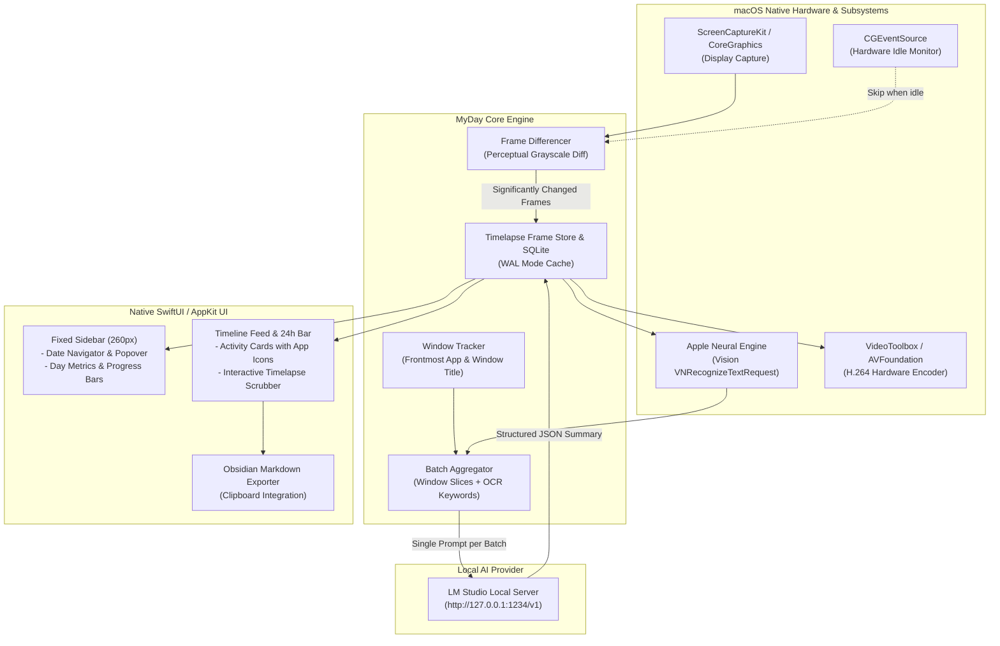

# MyDay ✦

<p align="center">
  <strong>Ultra-lightweight, 100% private native macOS activity journal & timelapse.</strong><br>
  Optimized for local LLMs via <strong>LM Studio</strong> with Apple Neural Engine OCR and hardware acceleration.
</p>

<p align="center">
  
  
  
  
  
  
</p>

---

## 💡 About MyDay

**MyDay** is an ultra-optimized native macOS analog of [Dayflow](https://github.com/JerryZLiu/dayflow), designed from the ground up for minimal memory usage, zero telemetry, and maximum local efficiency.

Instead of sending constant full-resolution screenshots to heavy cloud models, MyDay employs a **hardware-first, multi-tier intelligence pipeline**:
1. **Perceptual Screen Differencing**: Filters out static frames instantly using downsampled grayscale diffs without consuming CPU cycles.
2. **Hardware Idle Detection**: Suspends captures automatically via `CGEventSource` when you step away from your Mac.
3. **Apple Neural Engine OCR**: Extracts on-screen text keywords locally via Apple's native `VNRecognizeTextRequest` at zero LLM cost.
4. **Single-Pass Local LLM Summarization**: Sends lightweight window titles + OCR keywords + keyframes in batched intervals (5–15 minutes) to **LM Studio** (`qwen3-vl-4b-instruct`, `mistral`, `llama3`).
5. **Hardware H.264 Timelapse**: Generates smooth, accelerated session videos using VideoToolbox/AVFoundation with interactive hover-scrubbing.
6. **Obsidian Ready**: Exports structured Markdown journals with YAML frontmatter, timeline callouts, and activity tags in a single click.

---

## ✨ Features

- 🎨 **Linear & Raycast Aesthetic**: Sleek obsidian dark glassmorphism (`.ultraThinMaterial`), border gradients, and typography designed specifically for macOS.
- 🙈 **Automated Incognito & Private Window Exclusion**: Completely halts recording, captures zero screenshots, and records zero titles or URLs whenever private browsing is active across all major browsers (Zen, Safari, Chrome, Arc, Brave, Firefox, Edge, Opera, Tor, etc.).
- 📋 **Automated Unfinished Daily Tasks**: Day summary automatically detects started but unfinished tasks and formats them as a clean, actionable task-manager checklist with interactive checkmarks and 1-click Markdown export (Things, Obsidian, Apple Reminders, Todoist).
- 🎬 **Full-Day 60fps Timelapse & Donut Analytics**: Full day summary view featuring an ultra-smooth 60fps movie compilation alongside a segmented category time distribution donut chart and top apps breakdown.
- 🧩 **Multi-Tier Timeline Session Stitching**: Intelligently consolidates fragmented 5–10 minute activity slices into unified, cohesive working sessions while protecting against overnight sleep gaps.
- 🖼️ **Native Retina App Icons**: Real application icons extracted directly from macOS via `NSWorkspace` for all active windows (Xcode, Warp, Safari, Figma, Telegram, etc.).
- ⏱️ **Visual 24-Hour Day Grid**: Interactive hourly activity overview (`00:00 – 23:59`) with category-colored slots.
- 📅 **Custom Date Navigator & Popover**: Minimalist date switcher with quick jump chips (*Сегодня*, *Вчера*, *-7 дней*) and activity indicator dots on days with recorded sessions.
- 🎞️ **Cinematic Timelapse Scrubber**: Hover over any activity card to scrub through session screenshots in real time, or launch the hardware-accelerated video player with playback rate controls.
- 📊 **Intelligent Categorization**: Automatic classification into Development, Writing, Research, Communication, Design, Media, or System utilities.
- 📝 **1-Click Obsidian Export**: Copies the day's timeline into formatted Markdown with callouts, tags, and duration summaries.
- 🎛️ **Native Menu Bar Extra**: Discreet companion in the macOS menu bar for quick recording toggle and instant batch triggers.

---

## 🏗️ Architecture



---

## 🚀 Getting Started

### 📦 Download Prebuilt App

Download `MyDay-v0.1.0-macOS.zip` from [GitHub Releases](https://github.com/m1xxos/myDay/releases/latest), unzip, and move `MyDay.app` into your `/Applications` folder.

### Prerequisites

1. **macOS 14.0 (Sonoma)** or later (Apple Silicon recommended).
2. **LM Studio** installed and running:
   - Download from [lmstudio.ai](https://lmstudio.ai).
   - Load a model (recommended: `qwen3-vl-4b-instruct`, `llama-3.2-3b-instruct`, or any lightweight vision/text instruct model).
   - Start the **Local Inference Server** on port `1234` (`http://127.0.0.1:1234`).

### Build from Source

```bash
# 1. Clone repository
git clone https://github.com/m1xxos/myDay.git
cd myDay

# 2. Package and sign the native app bundle
chmod +x scripts/create_app_bundle.sh
./scripts/create_app_bundle.sh

# 3. Launch MyDay
open MyDay.app
```

> **Note on Permissions**:
> When prompted, grant **Screen Recording** permission in *System Settings → Privacy & Security → Screen & System Audio Recording*. If you just granted permission, click the **«Перезапустить»** button in the app banner to activate capture immediately.

---

## 🛠️ Configuration

Open **Настройки** (Settings) via the gear icon in the sidebar or menu bar:

| Setting | Default | Description |
| :--- | :--- | :--- |
| **LM Studio URL** | `http://127.0.0.1:1234/v1` | Local OpenAI-compatible API endpoint |
| **Active Model** | Auto-detected | Selects loaded model from LM Studio |
| **Analysis Mode** | `Text-First` | Text-first OCR or Vision-assisted multimodal analysis |
| **Capture Interval** | `20 sec` | Time between display state evaluations |
| **Diff Threshold** | `2.5%` | Minimum visual delta to save a new keyframe |
| **Batch Duration** | `10 min` | Frequency of local LLM summarization calls |
| **Idle Timeout** | `120 sec` | Suspends recording when no mouse/keyboard input |
| **Exclude Private Browsing** | `Enabled` | Automatically pauses recording on incognito windows |
| **Retention Days** | `7 days` | Automatic purge threshold for old raw frames |

---

## 📁 Project Structure

```text
myDay/
├── Package.swift                    # Swift Package Manager manifest
├── scripts/
│   ├── create_app_bundle.sh        # Automates build, packaging, icon & codesign
│   └── generate_icon.swift         # CoreGraphics Apple iconset & .icns generator
├── Resources/
│   └── AppIcon.icns                # Native macOS Retina icon (16x16 to 1024x1024)
├── Sources/MyDay/
│   ├── App/
│   │   └── AppState.swift          # MainActor state coordinator & capture loop
│   ├── Core/
│   │   ├── AI/                     # LM Studio client, heuristic extractor & prompts
│   │   ├── Capture/                # ScreenCaptureKit, differencing & window tracker
│   │   ├── Vision/                 # Apple Neural Engine OCR (Vision framework)
│   │   ├── Timelapse/              # Hardware H.264 compiler (AVFoundation)
│   │   ├── Storage/                # SQLite WAL database & frame storage
│   │   └── Export/                 # Obsidian Markdown exporter
│   └── Views/
│       ├── MainView.swift          # Root layout with fixed 260px sidebar & hidden titlebar
│       ├── SidebarView.swift       # Dark glass sidebar, metrics, categories & LM Studio status
│       ├── Timeline/               # Feed, DaySummary, 24h ActivityGridView, DateNavigator & Scrubber
│       ├── MenuBar/                # Native macOS MenuBarExtra companion
│       └── Settings/               # Preferences window
└── Tests/MyDayTests/               # Core engine unit tests
```

---

## 🧪 Testing

Run the full automated test suite:

```bash
swift test
```

Tests verify:
- Frame differencer accuracy on identical vs distinct displays.
- Hardware SQLite WAL persistence and date range queries.
- Activity categorization heuristics.
- Obsidian Markdown and YAML frontmatter formatting.
- Live LM Studio API communication and JSON schema validation.

---

## 🔒 Privacy Pledge

- **Zero Cloud**: 100% of data stays on your machine (`~/Library/Application Support/MyDay/`).
- **Zero Analytics**: No tracking, telemetry, or external network requests.
- **Local AI Only**: All prompts are sent exclusively to your local loopback address (`127.0.0.1:1234`).

---

## 📄 License

Released under the [MIT License](LICENSE).
Copyright © 2026 [m1xxos](https://github.com/m1xxos).
